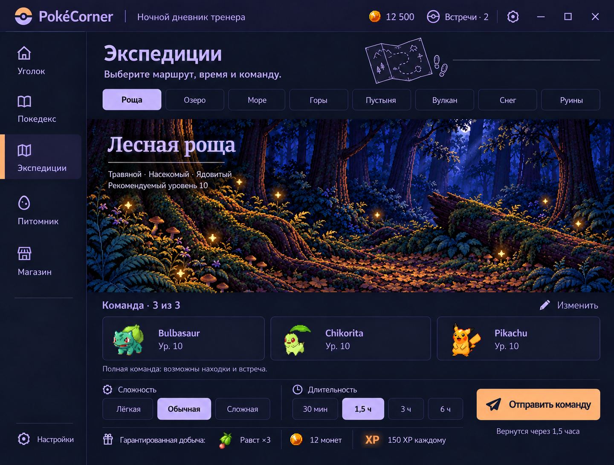
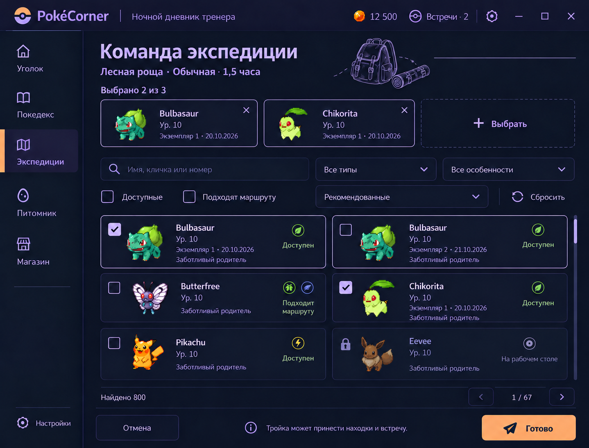
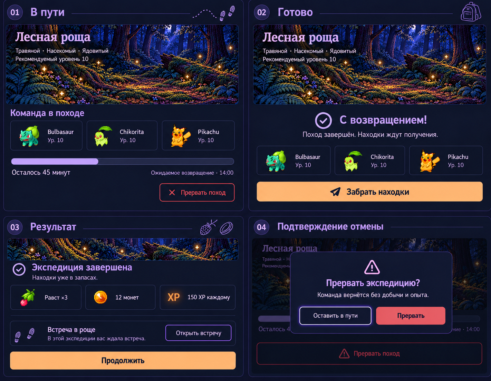
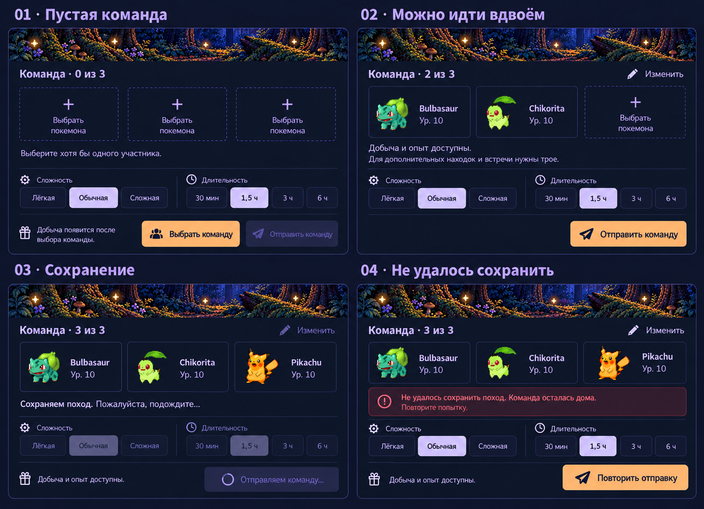
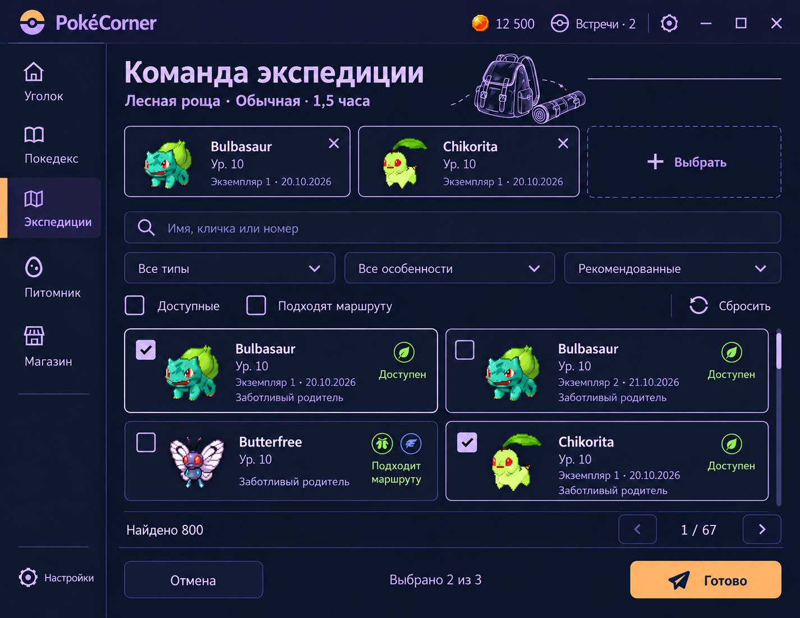
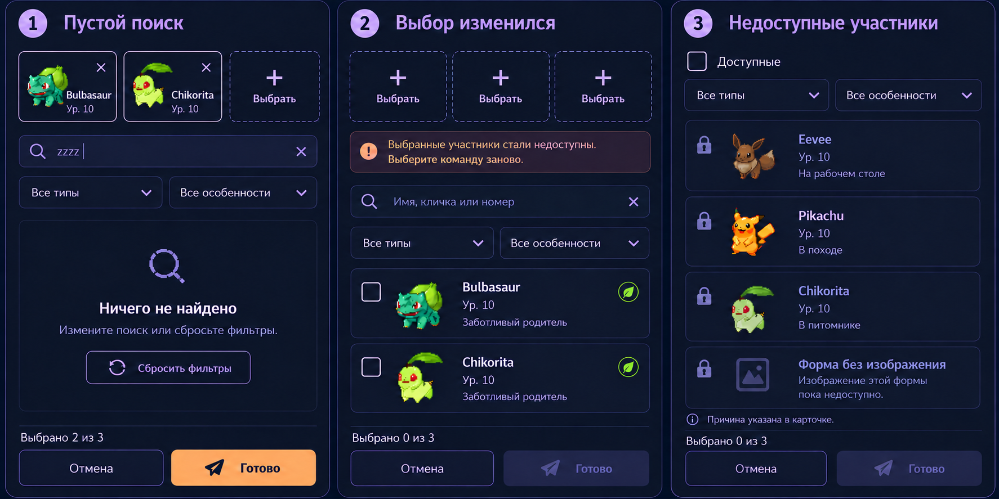
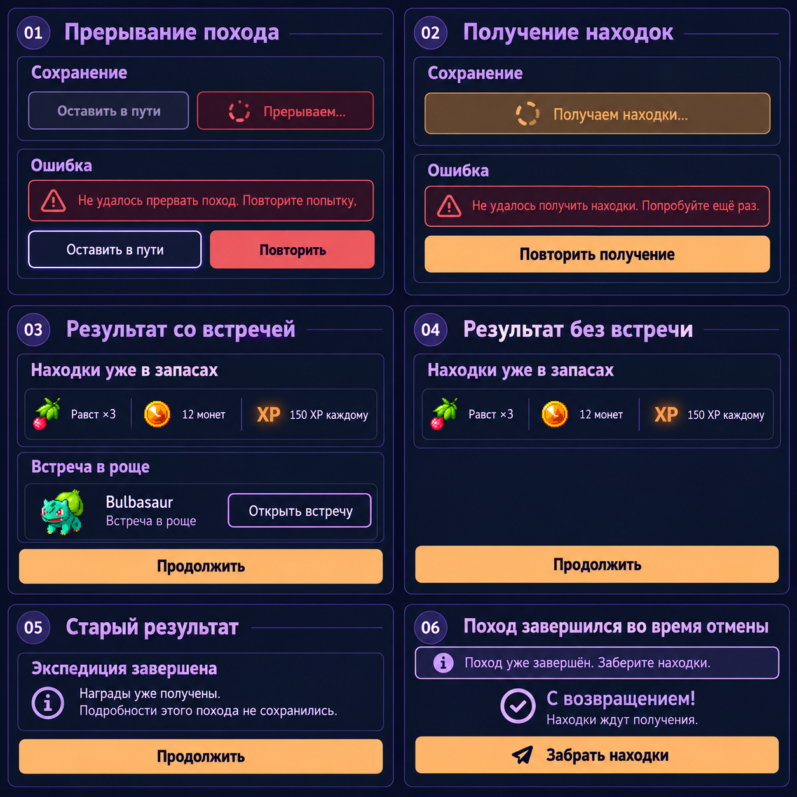

# Пилот экспедиций — ревизия 2 принята

**2026-10-21: R2 revision2 визуально принят пользователем.** [Запись принятия](ACCEPTANCE.md). Следующий R3/POKE-68 ещё не начат; runtime-ограничения сохранены.

Ночной дневник тренера · POKE-69 · 21 октября 2026.

[Открыть галерею всех экранов](review.html) · [Обязательные правила арта](../ART-DIRECTION.md)

Ревизия 2: сухая роща без воды; контекстные зарисовки вместо универсальных веточек. Версия 1 сохранена как история и больше не является текущим эталоном.

Это макеты, созданные встроенным imagegen, и спецификация для будущего WPF-пилота. Направление и подробная компоновка revision2 приняты пользователем 2026-10-21.

Точные дополнительные компоновки и карта возврата по snapshot: [STATE-COVERAGE.md](STATE-COVERAGE.md). Листы06–08 дополняют picker compact/варианты/lifecycle; полнота сопоставлена в VALIDATION.md; runtime этим не подтверждается.

## Подготовка · 1000×760

## Компактное окно · 840×650

## Подбор команды

## Поход и результат

## Пусто, небольшая команда, сохранение и отказ

[Правила компоновки и полный сценарий](SPEC.md) · [Сверка с ядром](TECHNICAL-CONTRACT.md) · [Промпты и исходники](manifest.json) · [Отдельный фон рощи](grove-environment-v2.png).

Два полных макета подготовки рассчитаны на два размера; подбор и другие состояния дополнены правилами compact в SPEC.md. Это не новая runtime-приёмка и не набор всех восьми готовых маршрутов.

## Компактный подбор команды

## Детали подбора: пусто и недоступность

## Детали отмены, получения и результата

[Матрица полноты и проверка артефактов](VALIDATION.md).
